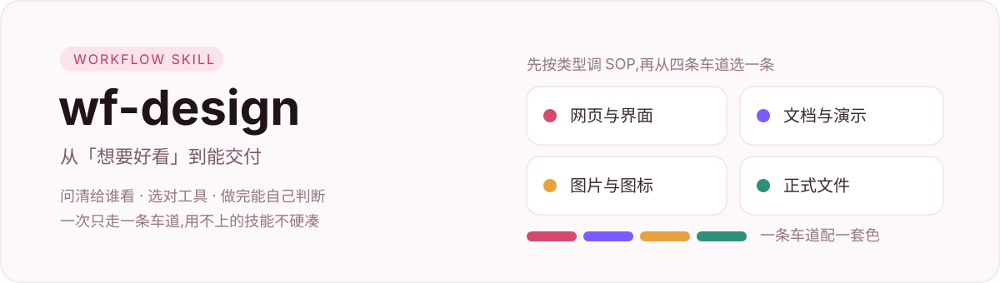

# wf-design



不懂设计也能参与设计：先明确任务与设计契约，再确认关键样板，复杂项目按切片制作和审查。工作流负责组织技能、交接和确认点，具体方法留在各技能本体。

## 怎么走

共同流程是:明确任务 → 核验事实与参考 → 设计契约 → 方向样板 → 制作与验收。

复杂项目增加真实垂直切片、逐片审查与集成验收；小改、已有参考或已有设计体系时不重复走全程。全新视觉方向按需比较候选，不固定数量。

## 场景 SOP

视觉设计按产物组织技能，场景 SOP 只补真正需要偏离底座的部分。知识笔记、教程和学习材料已分流，不再从设计流程进入。

- [SOP 索引](references/sops/index.md)
- [场景模板](references/sops/_template.md)

## 按产物组织

- **普通办公文档**:Word、PDF、PPT、Excel 与在线协作文档交给 `wf-office`；本工作流只保留视觉型演示与展示物料。
- **知识与学习材料**:普通笔记和教程交 `wf-office`，教学精加工交 `learning-material-design`，学习过程交 `wf-study`。
- **进阶应用**:网页、移动 App、桌面应用。
- **细节模块**:界面模块、图片、交互与交互动画。
- **视频**:连续镜头和 AI 视频，与交互动画分开。

**先取舍再动手**:不是每个技能每趟都用。简单任务只报当前环节、状态和下一步；复杂任务再展示阶段产物与子 Agent 分工。

进度状态包含进行中、等待确认、待验收、受阻和已超时；子 Agent 的任务、目的、模型和负责产物按实际情况展示。专业术语附一句人话和 VibeHub 链接，不用术语替代设计决定。

## 交付前自检

```bash
py -3 scripts/design_check.py check <路径>
```

检查标题、占位文字、图片路径、本机路径、SVG 和透明 PNG。退出码 1 表示有阻断项，先改再交。

## 安装

```bash
npx skills add hayou2002/wf-design
```

## 依赖

技能按需安装,一个不装也能走底座(只是产出靠通用能力)。生图优先走 MCP 的生图通道,需要脚本入口时才用 `image-gen`,也可自配。

## 同系列

- [wf-maker](https://github.com/hayou2002/wf-maker):把流程做成工作流 Skill
- [wf-github-ops](https://github.com/hayou2002/wf-github-ops):本地 Git 整理与 GitHub 上传
- [wf-vibecode](https://github.com/hayou2002/wf-vibecode):日常 Vibe Coding

## 许可

MIT
